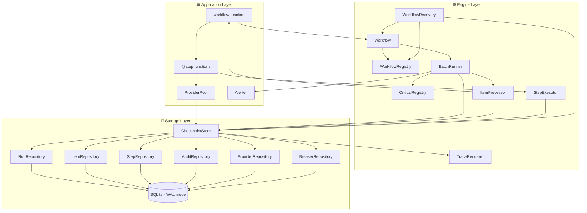
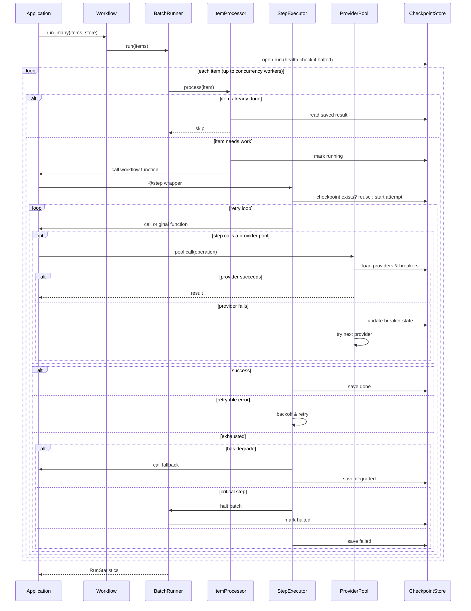
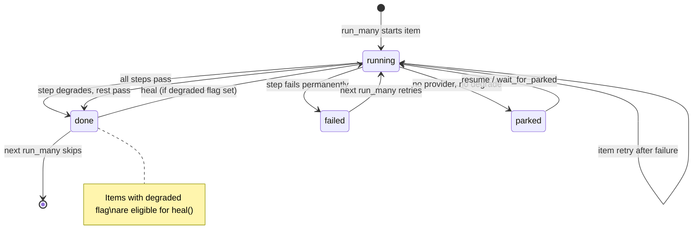

<p align="center">
  <h1 align="center">⛓️ stitch</h1>
  <p align="center">
    <strong>Durable, resumable async workflows for Python — zero dependencies.</strong>
  </p>
  <p align="center">
    <a href="#quick-start">Quick Start</a> ·
    <a href="#features">Features</a> ·
    <a href="#system-design">System Design</a> ·
    <a href="#samples">Samples</a> ·
    <a href="#api-reference">API Reference</a>
  </p>
</p>

---

**stitch** gives every async step a checkpoint, a retry budget, and a fallback — using nothing but the Python standard library. If a process crashes, a rerun picks up where it left off. If a dependency goes down, a circuit breaker parks or degrades the call and the batch keeps moving.

```bash
pip install stitch-durable
```

> [!NOTE]
> Python 3.11+. Distribution name: `stitch-durable`. Import name: `stitch_durable`. **Zero third-party dependencies.**

---

## Quick Start

```python
from stitch_durable import CheckpointStore, RetryPolicy, Workflow, step

@step(retry_policy=RetryPolicy(retry_on=(OSError,)))
async def download(article): ...

@step(degrade=quick_fallback)
async def analyse(article, text): ...

async def process(article):
    text = await download(article)
    await analyse(article, text)

store = CheckpointStore("state.db")
await Workflow(process, name="demo").run_many(articles, store)
```

Every completed step is checkpointed to SQLite before the next one starts. A rerun skips what's already done. When retries run out, `degrade` supplies a flagged fallback and the item still finishes. `WorkflowRecovery(store).heal()` redoes those degraded steps later.

---

## Features

### 🔖 Checkpoints

Each `@step` result is persisted to SQLite before the next step runs. On a later `run_many`:

- **Done items** → skipped entirely
- **Done/degraded steps** → result reused from the checkpoint
- **Interrupted steps** (left `running`) → re-executed, audit records the interruption

Calling a step twice in one item stores `name` then `name#2`. Outside a workflow, `@step` calls the function directly — perfect for unit tests.

### 🔁 Retries

`RetryPolicy` controls which exceptions trigger retries and how long to wait between them.

| Parameter | Default | Description |
|---|---|---|
| `maximum_attempts` | 4 | Total tries before giving up |
| `retry_on` | `(TransientError, TimeoutError)` | Exception types that trigger a retry |
| `base_delay_seconds` | 0.25 | Initial backoff delay |
| `maximum_delay_seconds` | 4.0 | Cap on backoff growth |
| `timeout_seconds` | `None` | Per-attempt timeout (raises `TimeoutError`) |

Delay is jittered between 50–100% of the computed backoff. An exception with a `retry_after` attribute overrides the delay. `PermanentError` always fails immediately. Pass `item_retry_policy` to `Workflow` to retry the entire item after a step failure — finished steps inside that retry are preserved.

### ↓ Fallbacks & Degradation

When retries are exhausted or no provider is free, the `degrade` function produces a flagged substitute result:

```python
def fallback(article, cause=None):
    return {"summary": article["id"], "source": "fallback"}

@step(degrade=fallback)
async def summarise(article): ...
```

- The step is stored as `degraded`, and later steps still run
- A plain rerun keeps the fallback — the item is marked done
- `WorkflowRecovery(store).heal()` deletes checkpoints from the first degraded step onward and retries

### 🅿️ Parking

When every provider is cooling down and there's no `degrade` function, the item is **parked** instead of failed:

```python
# Explicit parking
raise Park(time.time() + 30, "waiting on a file")

# Automatic parking — wait inside run_many
await workflow.run_many(items, store, wait_for_parked=True)

# Resume parked items later
await WorkflowRecovery(store).resume()
```

### 🛑 Critical Steps

A critical step halts the **entire batch** when a transient failure exhausts retries:

```python
@step(
    critical=CriticalPolicy(health_check=database_ok),
    retry_policy=RetryPolicy(maximum_attempts=2),
)
async def save(article, text): ...
```

- In-flight work is cancelled, one `Alerter` alert fires, the run is stored as `halted`
- Next `run_many` calls the health check first — if it fails, raises `HealthCheckFailed`
- Once healthy: a `recovered` alert fires, the run continues, finished steps are reused
- `PermanentError` in a critical step fails only that item
- A step **cannot** be both `critical` and `degrade` (raises `ValueError`)

### 🔌 Provider Pools & Circuit Breakers

`ProviderPool` manages multiple backends with automatic failover and per-provider circuit breakers:

```python
pool = ProviderPool(
    "llm",
    Client,
    default_providers=[("primary", 1, {}), ("backup", 2, {"region": "eu"})],
    tuning=BreakerTuning(quota_cooldown_seconds=60),
)

@step
async def summarise(article):
    return await pool.call(lambda client: client.complete(article["title"]))
```

| Trigger | Breaker Opens After | Cooldown |
|---|---|---|
| `QuotaExhausted` | 1 failure | `quota_cooldown_seconds` (60s) |
| `RateLimited` | 1 failure | `rate_limit_cooldown_seconds` (1s) |
| `ProviderDown`, `ConnectionError`, timeout | `failure_threshold` (3) | Exponential from `base_cooldown_seconds` (10s), capped at `maximum_cooldown_seconds` (120s) |

After cooldown, the next call **probes** the provider. A failed probe extends the cooldown; a success closes the breaker. Use `pool.snapshot(store)` to inspect each provider's state: `ready`, `cooling`, `probe`, or `disabled`.

### 📊 Audit Trail & Reporters

Every event is appended to the `audit` table. Use `TraceRenderer` for a formatted timeline, or subclass `Reporter` for live streaming:

```python
class LineReporter(Reporter):
    def on_step_retry(self, step, attempt, error, delay):
        print(f"{step} attempt {attempt} failed ({error}); retry in {delay:.2f}s")

stats = await workflow.run_many(items, store, reporter=LineReporter())
print(f"{stats.items_done} done, {stats.items_failed} failed, {stats.step_retries} retries")
```

`run_many` returns `RunStatistics` with counts: done, skipped, failed, parked, degraded, retried, failed-over.

---

## System Design

### Architecture



### Request Flow



### Item Lifecycle



### Key Design Decisions

| Decision | Rationale |
|---|---|
| **SQLite in WAL mode** | Single-file state, no external services, crash-safe writes |
| **Context variables** | The active run, item, and step propagate without threading them through every call |
| **Registry pattern** | `resume` and `heal` look up workflows by name — import the module before calling them |
| **One process, one file** | Simplifies concurrency; async workers share the connection |
| **JSON-serializable I/O** | Step results and inputs must round-trip through `json.dumps` |

---

## Samples

> Each program is self-contained. Run it where `import stitch_durable` works. It writes `state.db` in the working directory. Delete that file before re-running — finished items are skipped by design.

### 1 · Retry a step, then resume the failed item

`a` loses its connection twice then succeeds. `b` downloads fine, but indexing rejects it permanently. Clearing the fault and re-running the same batch skips `a` entirely and reuses `b`'s saved download.

```python
import asyncio

from stitch_durable import CheckpointStore, PermanentError, Reporter, RetryPolicy, Workflow, step

download_attempts = {}
search_down = {"b": True}


class LineReporter(Reporter):
    def on_step_retry(self, step, attempt, error, delay):
        print(f"{step} attempt {attempt} failed ({error}); retry in {delay:.2f}s")

    def on_item_failed(self, item, error):
        print(f"{item} failed: {error}")

    def on_step_skipped(self, step, item):
        print(f"{item}: {step} skipped")


@step(
    retry_policy=RetryPolicy(
        maximum_attempts=3,
        base_delay_seconds=0.01,
        maximum_delay_seconds=0.01,
        retry_on=(OSError,),
    )
)
async def download(article):
    key = article["id"]
    download_attempts[key] = download_attempts.get(key, 0) + 1
    if key == "a" and download_attempts[key] < 3:
        raise OSError("connection reset")
    return {"id": key, "text": f"body of {key}"}


@step
async def index(article, document):
    if article["id"] == "b" and search_down["b"]:
        raise PermanentError("search rejected the document")
    return {"id": document["id"], "words": len(document["text"].split())}


async def process(article):
    document = await download(article)
    return await index(article, document)


async def main():
    store = CheckpointStore("state.db")
    articles = [{"id": "a"}, {"id": "b"}]
    workflow = Workflow(process, name="demo")
    first = await workflow.run_many(articles, store, reporter=LineReporter())
    print(f"first run: {first.items_done} done, {first.items_failed} failed, {first.step_retries} retries")
    search_down["b"] = False
    second = await workflow.run_many(articles, store, reporter=LineReporter())
    print(
        f"second run: {second.items_skipped} skipped, {second.items_done} done, "
        f"{second.steps_skipped} steps reused"
    )
    store.close()


asyncio.run(main())
```

**Output:**

```text
b failed: index: search rejected the document
first run: 1 done, 1 failed, 2 retries
b: download skipped
second run: 1 skipped, 1 done, 1 steps reused
```

---

### 2 · Publish a fallback, then heal it

The only model is out of credits, so `summarise` stores a fallback and `publish` still runs. After the provider recovers, `heal()` deletes those checkpoints and re-runs both steps with real data.

```python
import asyncio

from stitch_durable import (
    BreakerTuning,
    CheckpointStore,
    ProviderPool,
    QuotaExhausted,
    TraceRenderer,
    WorkflowRecovery,
    step,
    workflow,
)


class Client:
    def __init__(self, name, config):
        self.name = name

    async def complete(self, text):
        if not healthy["ok"]:
            raise QuotaExhausted("insufficient credits")
        return f"{self.name}: {text}"


healthy = {"ok": False}
published = []
pool = ProviderPool(
    "llm",
    Client,
    default_providers=[("primary", 1, {})],
    tuning=BreakerTuning(quota_cooldown_seconds=0.2),
)


def fallback(article, cause=None):
    return {"summary": article["id"], "source": "fallback"}


@step(degrade=fallback)
async def summarise(article):
    text = await pool.call(lambda client: client.complete(article["id"]))
    return {"summary": text, "source": "llm"}


@step
async def publish(article, summary):
    published.append((article["id"], summary["source"]))
    return {"ok": True}


@workflow(name="triage")
async def handle(article):
    summary = await summarise(article)
    await publish(article, summary)
    return summary["source"]


async def main():
    store = CheckpointStore("state.db")
    first = await handle.run_many([{"id": "a"}], store)
    print("published", published, "degraded", first.items_degraded)
    healthy["ok"] = True
    await asyncio.sleep(0.35)
    healed = await WorkflowRecovery(store).heal()
    print("after heal", published, "degraded", healed["triage:default"].items_degraded)
    print(TraceRenderer().render(store.audit.list_records(item_key="a")))
    store.close()


asyncio.run(main())
```

**Trace output:**

```text
23:07:12.555 +   0.00s  ● started
23:07:12.555 +   0.00s    ▸ summarise started
23:07:12.555 +   0.00s    ! summarise: primary failed (QuotaExhausted): insufficient credits
23:07:12.555 +   0.00s    ⛔ breaker OPEN on primary for 0.2s: insufficient credits
23:07:12.555 +   0.00s    ↓ summarise used its fallback: no provider available in pool 'llm' (primary all cooling down)
23:07:12.555 +   0.00s    ✓ summarise done in 0.00s DEGRADED
23:07:12.555 +   0.00s    ▸ publish started
23:07:12.555 +   0.00s    ✓ publish done in 0.00s
23:07:12.555 +   0.00s  ■ finished (degraded: fallback results published)
23:07:12.907 +   0.35s  ♻ heal: redoing summarise,publish
23:07:12.908 +   0.35s  ● started again (was running)
23:07:12.908 +   0.35s    ▸ summarise started
23:07:12.909 +   0.35s    ? probing primary after its cooldown
23:07:12.909 +   0.35s    ✔ breaker closed on primary: it is healthy again
23:07:12.909 +   0.35s    → summarise: answered by primary
23:07:12.909 +   0.35s    ✓ summarise done in 0.00s
23:07:12.909 +   0.35s    ▸ publish started
23:07:12.909 +   0.35s    ✓ publish done in 0.00s
23:07:12.909 +   0.35s  ■ finished
```

---

### 3 · Fail over between providers

`primary` has no credits, so the pool automatically routes to `backup`. A snapshot confirms `primary` is cooling:

```python
import asyncio

from stitch_durable import CheckpointStore, ProviderPool, QuotaExhausted, Workflow, step


class Client:
    def __init__(self, name, config):
        self.name = name

    async def complete(self, text):
        if self.name == "primary":
            raise QuotaExhausted("insufficient credits")
        return f"{self.name}: {text}"


pool = ProviderPool(
    "llm",
    Client,
    default_providers=[("primary", 1, {}), ("backup", 2, {"region": "backup"})],
)


@step
async def summarise(article):
    return await pool.call(lambda client: client.complete(article["title"]))


async def handle(article):
    return await summarise(article)


async def main():
    store = CheckpointStore("state.db")
    workflow = Workflow(handle, name="summaries")
    await workflow.run_many([{"id": "a", "title": "durable workflows"}], store)
    print(store.items.get("summaries:default", "a").result)
    for row in pool.snapshot(store):
        print(row["name"], row["state"])
    store.close()


asyncio.run(main())
```

```text
backup: durable workflows
primary cooling
backup ready
```

---

### 4 · Park when all providers are down, then resume

With a single provider and no fallback, the item is parked. Once the provider recovers, `resume()` picks it back up:

```python
import asyncio

from stitch_durable import (
    BreakerTuning,
    CheckpointStore,
    ProviderPool,
    QuotaExhausted,
    Workflow,
    WorkflowRecovery,
    step,
)


class Client:
    def __init__(self, name, config):
        self.name = name

    async def complete(self, text):
        if not recovered["ok"]:
            raise QuotaExhausted("insufficient credits")
        return text


recovered = {"ok": False}
pool = ProviderPool(
    "llm",
    Client,
    default_providers=[("only", 1, {})],
    tuning=BreakerTuning(quota_cooldown_seconds=0.2),
)


@step
async def summarise(article):
    return await pool.call(lambda client: client.complete(article["id"]))


async def handle(article):
    return await summarise(article)


async def main():
    store = CheckpointStore("state.db")
    workflow = Workflow(handle, name="strict")
    first = await workflow.run_many([{"id": "a"}], store)
    print(f"parked {first.items_parked}, still parked {first.parked_remaining}")
    recovered["ok"] = True
    await asyncio.sleep(0.35)
    resumed = await WorkflowRecovery(store).resume()
    print(f"resumed {resumed['strict:default'].items_done}")
    store.close()


asyncio.run(main())
```

```text
parked 1, still parked 1
resumed 1
```

---

### 5 · Halt the run when a critical step stays down

`save` retries a transient database error then halts the batch. A second attempt is refused while the health check fails. Once the resource recovers, the run continues and reuses the already-checkpointed `gather` step:

```python
import asyncio

from stitch_durable import (
    Alert,
    Alerter,
    CheckpointStore,
    CriticalPolicy,
    CriticalStepFailed,
    HealthCheckFailed,
    RetryPolicy,
    TransientError,
    Workflow,
    step,
)

resource = {"down": True}


class PrintAlerter(Alerter):
    def send(self, alert: Alert) -> None:
        print(f"{alert.severity}: {alert.title}")


def database_ok() -> bool:
    return not resource["down"]


@step
async def gather(article):
    return article["id"]


@step(
    retry_policy=RetryPolicy(maximum_attempts=2, base_delay_seconds=0.01, maximum_delay_seconds=0.01),
    critical=CriticalPolicy(health_check=database_ok),
)
async def save(article, text):
    if resource["down"]:
        raise TransientError("database unavailable")
    return {"saved": text}


async def handle(article):
    text = await gather(article)
    return await save(article, text)


async def main():
    store = CheckpointStore("state.db")
    workflow = Workflow(handle, name="archive")
    articles = [{"id": "a"}]
    alerter = PrintAlerter()
    try:
        await workflow.run_many(articles, store, alerter=alerter)
    except CriticalStepFailed as error:
        print(error)
    try:
        await workflow.run_many(articles, store, alerter=alerter)
    except HealthCheckFailed as error:
        print(error)
    resource["down"] = False
    stats = await workflow.run_many(articles, store, alerter=alerter)
    print(f"resumed {stats.items_done} done, {stats.steps_skipped} steps reused")
    store.close()


asyncio.run(main())
```

```text
critical: save is down, the run is halted
critical step save failed for a: database unavailable
the run is halted and the resource behind save is still unhealthy: the health check returned False
recovered: save is healthy again, the run resumes
resumed 1 done, 1 steps reused
```

---

## API Reference

### Audit Events

| Area | Events |
|---|---|
| **Run** | `run_started` · `run_finished` · `run_halted` · `run_blocked` · `run_recovered` |
| **Item** | `item_started` · `item_done` · `item_skipped` · `item_failed` · `item_parked` · `item_retry` |
| **Step** | `step_started` · `step_done` · `step_skipped` · `step_failed` · `step_retry` · `step_degraded` · `step_waiting` |
| **Provider** | `provider_used` · `provider_failed` · `provider_registered` · `failover` · `breaker_opened` · `breaker_closed` · `breaker_probe` |
| **Other** | `heal_started` · `cooldown_wait` · `cooldown_over` · `critical_failure` · `alert_sent` · `alert_failed` |

### Item Status After Recovery

| Status | `run_many` (same items) | `resume` | `heal` |
|---|---|---|---|
| `running` | continues, finished steps skipped | continues | included if degraded flag set |
| `parked` | tries again | tries again | included if degraded flag set |
| `failed` | tries again | left failed | included if degraded flag set |
| `done` | skipped | left done | redone if degraded flag set |

---

## Tests

```bash
python -m unittest
```

No dependencies needed — no virtual environment required.

To lint with ruff and run the tests automatically before every `git commit`:

```bash
pre-commit install
```

---

## License

MIT
